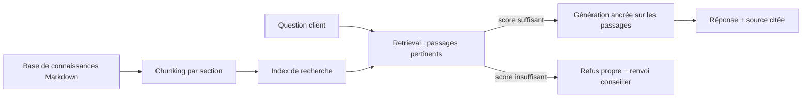

# RAG Support Assistant — Prototype documentaire

> **Projet personnel — données fictives.** La banque, la base de connaissances et les exemples sont entièrement synthétiques. Aucune clé API, aucun service externe : le prototype tourne en local, avec une génération **simulée**.
> **© 2026 Hamza Dziri — Tous droits réservés.** Projet personnel publié à titre de démonstration ; toute reproduction ou réutilisation, totale ou partielle, sans autorisation écrite préalable de l'auteur est interdite.

## Objectif

Concevoir un assistant de support qui répond aux questions des clients sur le parcours d'onboarding (signature en ligne, vérification d'identité, code de confirmation) **uniquement à partir d'une base d'aide contrôlée** — jamais à partir des connaissances générales d'un modèle.

Le sujet du projet n'est pas le code : c'est la **conception produit** d'un assistant fiable (périmètre, sources, garde-fous, critères d'évaluation).

## Architecture



## Choix d'indexation

| Choix | Décision | Justification |
|---|---|---|
| Unité de découpage | **Une section Markdown = un chunk** | La base d'aide est rédigée en sections autonomes (une question = une section) : le découpage épouse la structure éditoriale au lieu de la casser en fenêtres arbitraires |
| Recherche (prototype) | **Recouvrement lexical** (mots partagés, hors mots vides) | Zéro dépendance, comportement explicable et débogable — suffisant pour démontrer le pipeline |
| Recherche (production) | **Embeddings + recherche vectorielle**, éventuellement hybride (lexical + sémantique) | Le lexical échoue sur les synonymes (« annuler » vs « rétracter », cas documenté dans `examples/qa-examples.md`) ; les embeddings capturent la proximité de sens |
| Taille de contexte | Top 1 à 3 passages | Au-delà, le bruit augmente et la réponse se dilue ; la base est petite et chaque section est autonome |

## Garde-fous

1. **Seuil de pertinence** : si aucun passage n'atteint le score minimal, l'assistant refuse de répondre et renvoie vers un conseiller. Mieux vaut un refus qu'une invention (cas Q4 des exemples : le taux d'un financement n'est pas dans la base, et ne doit pas y être).
2. **Ancrage obligatoire** : la génération ne reçoit que les passages retrouvés, avec consigne de n'utiliser qu'eux ; la source est citée dans la réponse.
3. **Périmètre fermé** : l'assistant ne traite que les sujets de la base (onboarding). Toute question hors périmètre suit le même chemin que le garde-fou n° 1.
4. **Aucune donnée client** : la base ne contient que de l'aide générique ; les données de dossier (montants, taux, statuts personnels) restent dans les systèmes métier, jamais dans l'index.

## Contenu du dépôt

| Fichier | Contenu |
|---|---|
| `knowledge-base/` | 4 documents d'aide fictifs (parcours de signature, identité, OTP, après-signature) |
| `src/rag_pipeline.py` | Pipeline lisible en un fichier : chargement → chunking → recherche → génération simulée |
| `examples/qa-examples.md` | 4 questions testées, dont un cas limite (synonymes) et un refus correct |

## Exécution

```bash
python3 src/rag_pipeline.py "Combien de temps le code SMS est-il valable ?"
python3 src/rag_pipeline.py "Quel est le taux de mon financement ?"   # → refus propre
```

## Évaluation — comment je jugerais ce prototype

- **Taux de réponses ancrées** : part des réponses dont chaque affirmation figure dans le passage cité.
- **Taux de refus corrects** : sur un jeu de questions hors base, l'assistant doit refuser 100 % du temps.
- **Pertinence du passage retrouvé** : sur un jeu de questions de référence, le bon document doit arriver en top 1.

## Limites assumées

- La génération est **simulée** (le passage retrouvé est restitué dans un gabarit) : brancher un modèle réel changerait cette étape, pas l'architecture ni les garde-fous.
- La recherche lexicale du prototype est volontairement simple ; ses échecs sont documentés plutôt que masqués.

---

*Projet personnel de démonstration — toutes les données sont fictives. Badge Generative AI Practitioner (2025) — ce prototype illustre la partie « conception produit » de l'IA générative appliquée au support.*
